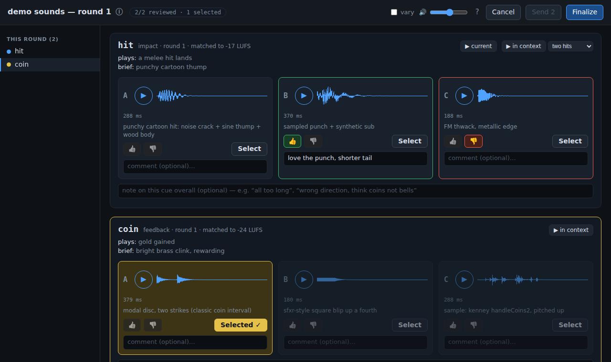
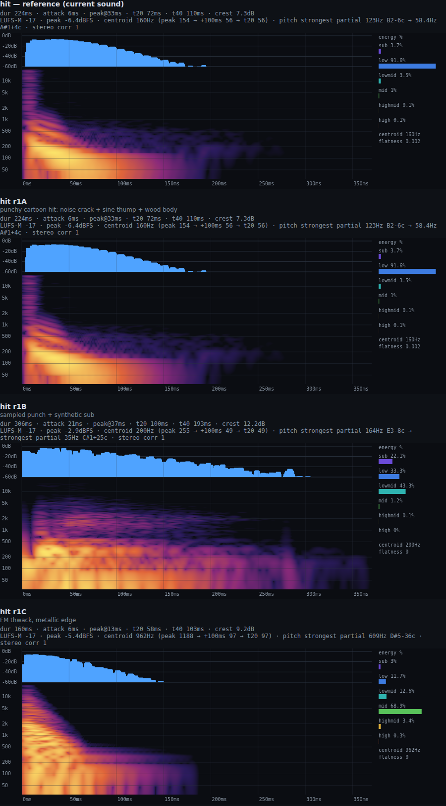

# soundset

Game sound effects designed by an AI agent and chosen by your ears. Each round, the agent writes 3 synth candidates per sound. You listen in the browser and either **Select** one (done) or 👍/👎 and comment (3 new ones next round). Selected sounds are baked to `.ogg` files with a tiny in-game player.



## Why it works
- **Agents can't hear, so they get eyes.** `soundset look` renders a spectrogram, an envelope and metrics (loudness, attack, decay, band energy, centroid, pitch) that the agent reads, and `docs/` is a compiled reference: synthesis recipes per sound type, mixing and loudness targets, game-audio design principles, and a table that turns comments ("too clicky", "more subtle") into parameter moves.
- **Fair listening.** Every candidate is loudness-matched (BS.1770), because the louder one otherwise wins. You can also play the old sound ("▶ current") or the candidate inside a game moment ("▶ in context").
- **A real synth.** Web Audio rendered offline in Chrome: oscillators with unison, FM, noise colors, Karplus-Strong plucks, modal resonators (wood, glass, bells, coins), CC0 samples, filter/pitch/amp envelopes, drive, a bus compressor, reverb and delay. What you hear in review is bit-for-bit what gets baked.



## Install
Needs Node ≥20, Google Chrome and ffmpeg.
```sh
git clone https://github.com/westonkelliher/soundset && cd soundset && npm install
ln -s "$PWD/bin/soundset" ~/.local/bin/soundset   # or anywhere on PATH
soundset doctor && soundset lib fetch            # check setup; download CC0 Kenney packs (~600 samples)
soundset demo                                    # try the review page on a throwaway 2-cue project
```

## Use it with your agent
1. In your game's repo, tell your coding agent: *"Set up soundset for this game's sound effects. Read `<path to soundset>/CLAUDE.md`."* It finds the sound events in your code, drafts a cue list, briefs and a sonic palette, and asks you to confirm.
2. Each round the agent writes and checks 3 candidates per cue (5–20 min), then the review page opens in Chrome. You listen and Select, or 👍/👎 and comment (about a minute per cue). `?` on the page explains everything.
3. Repeat. Most cues settle in 2–4 rounds. The agent bakes selected sounds into the game (`const sfx = await createPlayer({base: "sfx/"}); sfx.play("impact")`); you play it and say what's too loud or quiet.

`soundset help` lists every command; `soundset status` says what's next in a project. Project format: [docs/project-format.md](docs/project-format.md).

## Status
In use: an auto-battler deckbuilder's 18 cues, 15 selected after 3 rounds. Not yet done:
- no live "tweak a knob" audition page; all changes go through rounds
- peaks are sample peaks, not true-peak; the pitch readout is approximate on glides and chords
- bakes `.ogg` only (older Safari needs another format)

## License
Sounds you make are entirely yours. The code is MIT with an attribution requirement: credit "soundset by Weston Kelliher". See [LICENSE](LICENSE).
